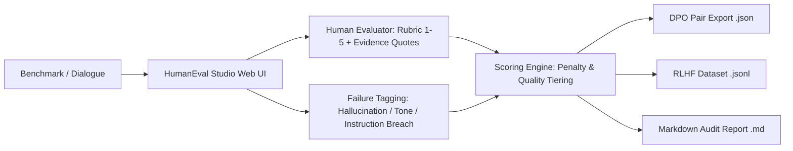

# 🎙️ HumanEval Studio

> **Human-in-the-Loop Multi-Turn Conversation Review & RLHF Annotation Platform**  
> Built for AI Chatbot Testers, RLHF annotators, and LLM alignment teams.

---

## 🌟 Overview

**HumanEval Studio** is a standalone, production-ready conversation review platform designed to evaluate AI chatbots across multi-turn interactions. It enables human evaluators to decompose conversation quality into standardized 5-point Likert rubrics (*Helpfulness, Accuracy, Tone, Safety, Clarity*), cite exact evidence quotes, assign failure categories (hallucination, sycophancy, instruction violation), and export high-quality training pairs formatted for **Direct Preference Optimization (DPO)** and **RLHF fine-tuning**.



---

## 🎯 Alignment with Alignerr AI Chatbot Tester Role

| Alignerr Job Requirement | How HumanEval Studio Proves It |
|---|---|
| *"Engage AI chatbots in conversations spanning everyday to complex scenarios"* | Pre-seeded with multi-turn medical dosage advice, technical constraint traps, and epistemic humility benchmarks. |
| *"Evaluate responses for helpfulness, accuracy, tone, and safety"* | Standardized 5-dimension rubric scoring with explicit descriptors (1 = Defective, 5 = Flawless). |
| *"Identify problems like factual errors, awkward phrasing, bias, or inappropriate outputs"* | Built-in failure taxonomy: `hallucination`, `sycophancy`, `unnatural_tone`, `instruction_violation`, `over_refusal`, `reasoning_error`. |
| *"Submit structured, detailed feedback that directly informs AI improvements"* | Generates actionable audit reports requiring evidence quotes and rationale before marking a response training-ready. |

---

## 🛠️ Tech Stack & Features

* **Backend:** FastAPI, Python 3.12, Pydantic v2 schemas.
* **Frontend:** Responsive conversation review canvas with live turn inspector and rubric scorecards.
* **Scoring Algorithm:** Automated penalty weighting calculating Adjusted RLHF Quality Score and assigning Quality Tiers (`HIGH_QUALITY_GOLD`, `ACCEPTABLE`, `NEEDS_REVISION`, `REJECTED`).
* **Export Engines:**
  * **DPO Format:** `{"prompt", "chosen", "rejected", "feedback_rationale"}`
  * **JSONL Dataset:** Standard Hugging Face TRL fine-tuning format.
  * **Markdown Report:** Formatted audit breakdown with quote citations.
* **Testing & CI:** Pytest with 100% test pass rate, GitHub Actions CI workflow, and Dockerfile.

---

## 🚀 Quick Start

### 1. Run Locally with Python

```bash
python -m venv .venv
source .venv/bin/activate  # Or on Windows: .\.venv\Scripts\Activate.ps1
pip install -e ".[dev]"
pytest
uvicorn app.main:app --reload --port 8000
```
Open **`http://localhost:8000`** in your browser.

### 2. Run with Docker

```bash
docker build -t humaneval-studio .
docker run -p 8000:8000 humaneval-studio
```

---

## 📡 API Endpoints

| Method | Endpoint | Description |
|---|---|---|
| `GET` | `/health` | Health check probe |
| `GET` | `/benchmarks` | List pre-seeded dialogue scenarios |
| `POST` | `/api/reviews` | Submit conversation annotation and compute scorecard |
| `GET` | `/api/reviews` | List all review sessions |
| `GET` | `/api/reviews/{id}/report` | Download Markdown audit report |
| `GET` | `/api/reviews/{id}/dpo` | Download DPO pair JSON |
| `GET` | `/api/export/jsonl` | Download full dataset in JSONL format |

---

## 📄 License
MIT License. Created by [Sri Ram Kunamsetty](https://github.com/SriRamKunamsetty).
